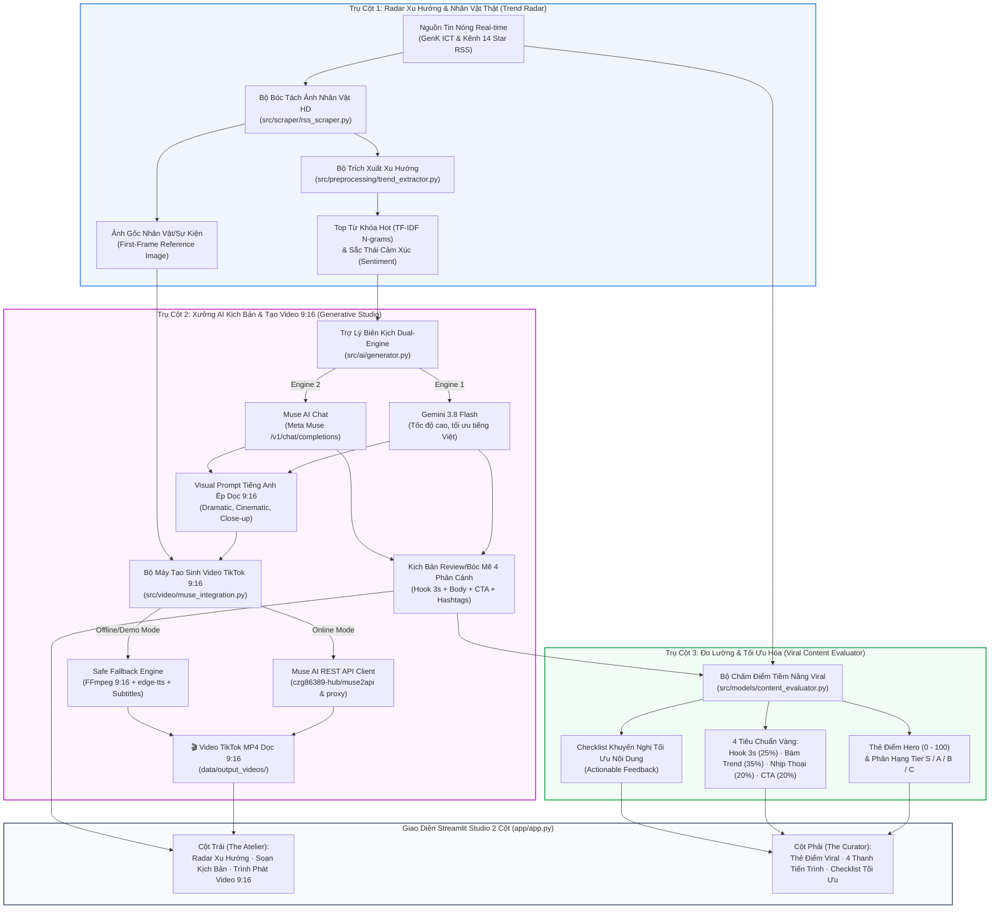

# The Pulse Editorial — Hệ Thống Phân Tích Xu Hướng Mạng Xã Hội & Tối Ưu Bài Đăng Tích Hợp AI Tạo Sinh

> **Đề tài Đồ Án:** *Xây dựng hệ thống phân tích xu hướng mạng xã hội và tối ưu bài đăng tích hợp AI tạo sinh.*  
> **Kiến trúc cốt lõi:** 100% Python thuần (TUYỆT ĐỐI KHÔNG DÙNG n8n), xây dựng theo mô hình **RAG Đa Phương Thức (Multimodal Pipeline)**: **Cào tin nóng thời gian thực $\rightarrow$ Tối ưu kịch bản Review/Bóc Mẽ 4 phân cảnh $\rightarrow$ Trích xuất ảnh nhân vật thật $\rightarrow$ Muse AI sinh video dọc TikTok 9:16 $\rightarrow$ Chấm điểm tiềm năng Viral 0 - 100**.

---

## 🏛️ 1. Sơ Đồ Kiến Trúc Hệ Thống (System Architecture)



---

## 📁 2. Cấu Trúc Mã Nguồn (Modular Clean Architecture)

```text
D:\pulse-studio\
├── data/
│   ├── raw/                      # Dữ liệu thu thập gốc
│   ├── processed/                # Dữ liệu đặc trưng đã làm sạch
│   └── output_videos/            # Nơi lưu trữ các video TikTok MP4 tạo sinh
├── src/
│   ├── preprocessing/            # Trích xuất xu hướng & Xử lý văn bản
│   │   ├── trend_extractor.py        # [M1] Trích xuất Top từ khóa TF-IDF N-grams & Sentiment Polarity
│   │   ├── text_cleaner.py           # Chuẩn hóa Unicode NFC, regex lọc URL, dọn dẹp ký tự
│   │   └── feature_extractor.py      # Bóc tách đặc trưng văn bản & cảm xúc
│   ├── scraper/                  # Thu thập tin tức thời gian thực
│   │   └── rss_scraper.py            # [M1] Cào tin RSS & Bóc tách ảnh nhân vật HD làm Reference Image
│   ├── ai/                       # Tầng AI tạo sinh kịch bản
│   │   └── generator.py              # [M2] Dual-Engine (Gemini 3.8 Flash & Muse Chat), Prompt 4 phân cảnh & Visual Prompt 9:16
│   ├── video/                    # Tầng tạo sinh video TikTok 9:16
│   │   └── muse_integration.py       # [M3] Client Muse AI REST API (czg86389-hub/muse2api) & Safe Fallback Engine
│   └── models/                   # Tầng đo lường & đánh giá
│       └── content_evaluator.py      # [M4] Bộ chấm điểm tiềm năng Viral 0 - 100 & Checklist tối ưu
├── app/                          # Giao diện người dùng Streamlit Studio 2 Cột
│   ├── app.py                        # [M5] Điểm khởi chạy chính (Layout 2 cột Atelier - Curator)
│   └── components/
│       ├── editorial_masthead.py     # Header phong cách ấn phẩm báo chí, trạng thái Dual AI
│       ├── editorial_atelier.py      # [M5] Cột trái: Radar xu hướng, Soạn kịch bản, Tạo video & Trình phát 9:16
│       ├── editorial_curator.py      # [M5] Cột phải: Bảng điểm Hero 0-100, 4 thanh đo & Checklist tối ưu
│       ├── editorial_styles.py       # Hệ thống CSS Editorial Minimalist
│       └── editorial_utils.py        # Tiện ích làm sạch HTML chống XSS
├── tests/                        # Bộ kiểm thử tự động toàn diện
│   ├── test_m1_trend_radar.py        # Test cào RSS, từ khóa TF-IDF & ảnh nhân vật
│   ├── test_m2_script_generator.py   # Test bộ sinh kịch bản Dual-Engine
│   ├── test_m3_muse_integration.py   # Test Muse AI client & Render video thực tế
│   ├── test_m4_content_evaluator.py  # Test chấm điểm 4 tiêu chí & phân hạng S/A/B/C
│   └── test_tiktok_pipeline.py       # [M6] Kiểm thử tích hợp End-to-End toàn bộ chuỗi cung ứng
├── .env.example                  # Mẫu cấu hình biến môi trường
├── requirements.txt              # Danh mục thư viện Python
└── run_app.bat                   # File thực thi 1-click khởi chạy ứng dụng
```

---

## ⚡ 3. Ba Trụ Cột Đột Phá Kỹ Thuật

### Trụ Cột 1: Radar Xu Hướng & Kỹ Thuật Image-to-Video
- **Bài toán:** Các mô hình video AI nếu chỉ dùng chữ thuần túy (Text-to-Video) sẽ vẽ ra người ảo ngẫu nhiên, không khớp với nhân vật trong tin thời sự thật.
- **Giải pháp:** Hệ thống tự động bóc tách **ảnh chụp thật của nhân vật/sự kiện** từ bài báo RSS làm **Reference Image** nạp vào Muse AI. Nhờ đó video tạo ra giữ đúng nhận diện khuôn mặt và trang phục của nhân vật thực tế!

### Trụ Cột 2: Dual-Engine Biên Kịch & Safe Fallback Video Engine
- **Dual-Engine Biên Kịch:** Người dùng có thể linh hoạt chuyển đổi giữa **Gemini 3.8 Flash** (tốc độ cao, tối ưu văn phong Việt Nam) và **Muse AI Chat** (`/v1/chat/completions`). Kịch bản sinh ra tuân thủ cấu trúc **Review / Bóc Mẽ 4 phân cảnh**: Hook 3s $\rightarrow$ Body bóc tách $\rightarrow$ CTA tranh luận $\rightarrow$ Hashtags.
- **Safe Fallback Engine (Cực kỳ quan trọng khi bảo vệ đồ án):** Hệ thống tích hợp sẵn engine dự phòng cục bộ sử dụng FFmpeg + `edge-tts` (thuyết minh tiếng Việt) + hiệu ứng Pan-Zoom ảnh dọc 9:16 + phụ đề TikTok chữ vàng viền đen to bản ở trung tâm. **Đảm bảo 100% luôn có video phát mượt mà trong 1 giây ngay cả khi trường mất mạng hoặc tài khoản Muse hết credit!**

### Trụ Cột 3: Bộ Đo Lường Tiềm Năng Viral Minh Bạch (0 - 100 Điểm)
Thay thế toàn bộ mô hình xác suất giờ đăng 24h cũ bằng 4 tiêu chuẩn vàng của thuật toán TikTok:
1. **Hook Strength (25%):** Đánh giá 3s đầu (ngắn < 15 từ, có từ khóa giật gân/bóc mẽ, có dấu hỏi kích thích tò mò).
2. **Trend Alignment (35%):** Khoảng cách Cosine Similarity giữa vector TF-IDF của tin tức gốc và kịch bản tạo ra.
3. **Pacing & Length (20%):** Đo độ dài thoại tối ưu (60 - 110 từ tương đương 20 - 40s nói).
4. **Call-To-Action (20%):** Nhận diện từ khóa kêu gọi bình luận và tranh luận ở đoạn kết.
5. **Xếp hạng:** Hạng S ($\ge 85$), Hạng A ($70 - 84$), Hạng B ($50 - 69$), Hạng C ($< 50$) kèm Actionable Checklist.

---

## 🚀 4. Hướng Dẫn Cài Đặt & Khởi Chạy

### Yêu Cầu Môi Trường
- **Python:** 3.10 hoặc 3.11
- **FFmpeg:** Đã có sẵn trong Windows PATH hoặc WinGet

### Bước 1: Khởi Tạo Môi Trường
```powershell
cd D:\pulse-studio
.venv\Scripts\activate
```

### Bước 2: Cấu Hình Biến Môi Trường ([.env](file:///D:/pulse-studio/.env))
```env
ROUTER_BASE_URL=http://127.0.0.1:8045/v1
ROUTER_API_KEY=your_gemini_api_key
ROUTER_MODEL=gemini-3.8-flash-medium

MUSE_BASE_URL=http://localhost:8000/v1
MUSE_API_KEY=
MUSE_MODE=auto
```

### Bước 3: Chạy Kiểm Thử Toàn Diện (E2E Integration Test)
```powershell
.venv\Scripts\python.exe tests/test_tiktok_pipeline.py
```
*(Kết quả: `ALL E2E INTEGRATION TESTS PASSED 100%!`)*

### Bước 4: Khởi Chạy Ứng Dụng Streamlit Studio
```powershell
.venv\Scripts\streamlit.exe run app/app.py
```
Ứng dụng sẽ tự động mở trên trình duyệt tại địa chỉ: `http://localhost:8501`.

---

## 🎓 5. Kịch Bản Thuyết Trình & Trả Lời Phản Biện Trước Hội Đồng

### Câu hỏi 1: *"Tại sao không dùng trực tiếp Muse AI trên web mà phải xây dựng hệ thống này?"*
> **Trả lời:**  
> *"Thưa thầy cô, các mô hình tạo sinh như Muse AI nếu dùng độc lập sẽ bị điểm yếu chí mạng là **ảo giác (hallucination), không cập nhật được tin tức thời sự mạng xã hội Việt Nam theo phút**, và không tạo được video đúng nhân vật thực tế nếu không có dữ liệu nguồn.  
> Hệ thống của em giải quyết bài toán này bằng kiến trúc **RAG Đa phương thức (Multimodal Pipeline)**: Tự động rà soát xu hướng thật $\rightarrow$ Tối ưu kịch bản bóc mẽ $\rightarrow$ Trích xuất ảnh thật của nhân vật $\rightarrow$ Cung cấp đầu vào hoàn chỉnh cho Muse AI render. Nhờ vậy video tạo ra vừa chính xác theo tin tức thật, vừa giữ đúng nhân vật, vừa đạt chuẩn tối ưu để viral trên TikTok!"*

### Câu hỏi 2: *"Hệ thống có phụ thuộc vào các công cụ No-code như n8n không?"*
> **Trả lời:**  
> *"Dạ hoàn toàn không. Toàn bộ mã nguồn từ cào dữ liệu RSS, xử lý NLP TF-IDF, gọi mô hình AI, kết nối REST API đến render video dọc 9:16 đều được viết bằng **100% Python thuần**, tuân thủ nguyên tắc Clean Code và Separation of Concerns để dễ bảo trì và mở rộng."*

---

© 2026 **The Pulse Editorial Studio** · Đồ Án Tốt Nghiệp Khoa Học Dữ Liệu & Trí Tuệ Nhân Tạo.
